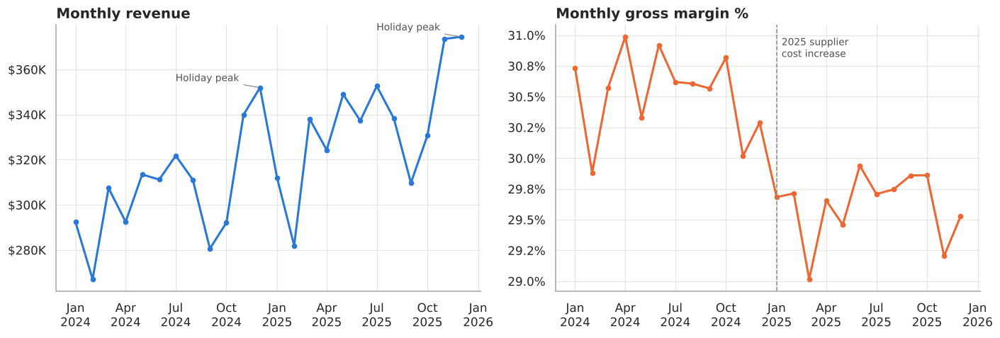
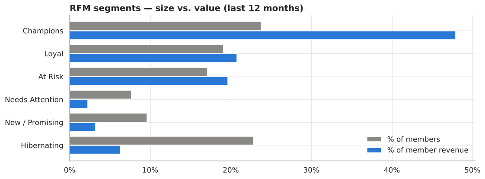
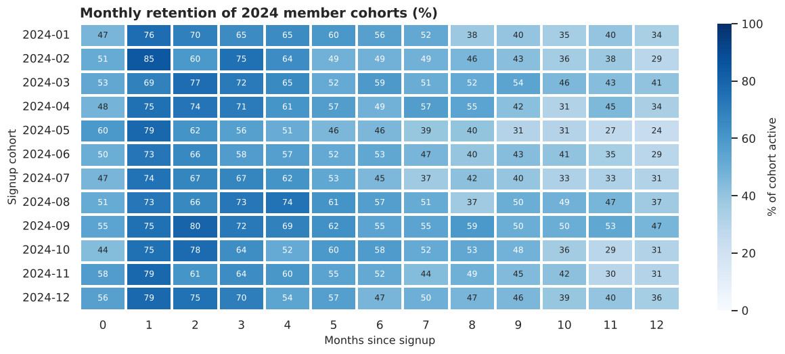
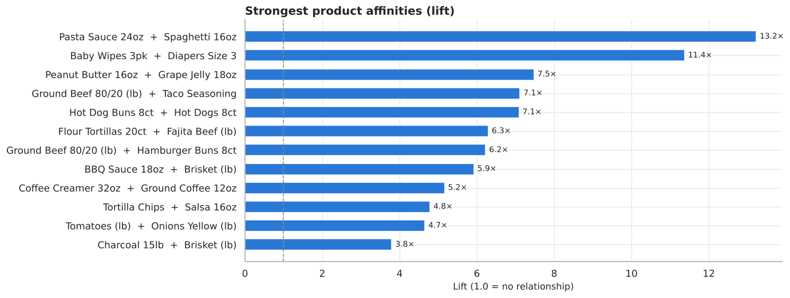
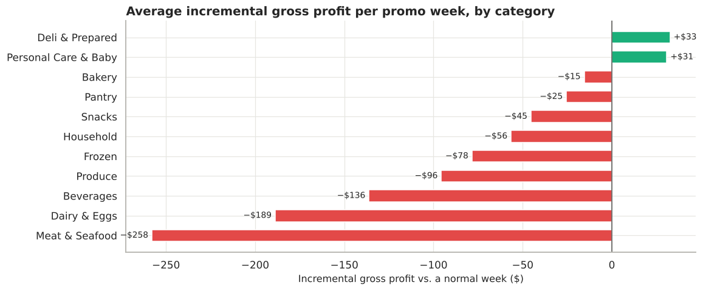
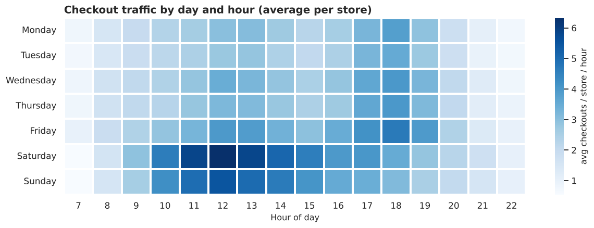

# 🛒 Texas Supermarket Chain — Retail Sales & Customer Analytics

End-to-end retail analytics on two years of point-of-sale data (~158K receipts, ~1.1M line items) for a 5-store Texas supermarket chain, answering the questions a grocery leadership team asks when planning next year's budget: **Where is growth coming from? Which promotions make money? Which customers are we losing? How should we staff and merchandise?**

[](https://colab.research.google.com/github/Abuabrar09/supermarket-retail-analytics/blob/main/Supermarket_Sales_Analysis.ipynb)

**Tools:** Python (pandas, NumPy) · SQL (SQLite — CTEs, window functions) · Matplotlib / Seaborn · Google Colab

---

## ⭐ Key Findings

| Area | Finding | Recommendation |
|---|---|---|
| **Growth** | Revenue **+9.2%** YoY, but gross profit only **+6.0%**: margin fell 0.9 pts as supplier costs (+5%) outpaced shelf prices (+3.5%) | Targeted price review and supplier renegotiation |
| **Promotions** | **~80% of promo weeks lose gross profit**; Meat, Dairy & Beverage deals lose money every week | Cap low-margin discounts at 15–20%; shift spend to high-margin categories and bundles |
| **Customers** | Loyalty members are 35% of receipts but **48% of revenue** ($66 vs $40 basket) | Push card sign-ups at checkout |
| **Churn risk** | 355 "At Risk" members hold **20% of member revenue** and haven't visited in ~5 months | Automated win-back offer at 30–45 days of inactivity |
| **Retention** | Only **52%** of new members are active after 6 months, **34%** after 12 | 90-day onboarding journey |
| **Products** | Deli & Bakery = 16% of sales but **25% of profit**; strong Texas meal affinities (fajita beef + tortillas, brisket + BBQ sauce) | Cross-merchandising and bundle deals |
| **Operations** | Saturday traffic **+41%** vs average; Thanksgiving Eve is **~2×** a normal day | Re-balance labor toward peak windows |



---

## 📊 What's Inside the Notebook

1. **Business problem & data model**: five relational POS tables (stores, products, customers, transactions, line items)
2. **Data quality & cleaning**: duplicate POS rows, returns (negative quantities), inconsistent category labels, referential-integrity checks
3. **Executive KPIs**: revenue, gross margin, traffic, basket size, YoY decomposition (traffic vs. price vs. items)
4. **Traffic patterns**: day × hour heatmap, peak days, holiday effects
5. **Anomaly detection**: robust z-score (median/MAD, same-weekday baseline) that automatically catches a storm closure
6. **Category & product performance**: revenue share vs. profit share, Pareto analysis
7. **Store performance**: YoY growth and space productivity (sales per sq ft, indexed)
8. **Customer analytics**: member vs. walk-in, **RFM segmentation**, **cohort retention** heatmap
9. **Market basket analysis**: support, confidence and lift computed from scratch with matrix algebra
10. **Promotion effectiveness**: unit lift and incremental gross profit by discount depth and category
11. **SQL analysis**: MoM/YoY growth with `LAG`, top-N per category with `RANK() OVER (PARTITION BY ...)`, store scorecard with CTEs, visit-gap analysis, payment mix
12. **Summary & recommendations**: an action table for leadership

| Customer segments | Cohort retention |
|---|---|
|  |  |

| Product affinities | Promo profitability |
|---|---|
|  |  |



---

## 💾 About the Data

The dataset is **simulated** to mirror a real grocery POS system. It includes realistic weekly and seasonal patterns, Texas holidays, product affinities, weekly promotions, loyalty-member churn, 2025 price and cost inflation, a weather-related store closure, and deliberate data-quality issues.

- The generator is built into the notebook with a fixed random seed, so **every result is reproducible** in Google Colab with no uploads.
- To keep it fast in free Colab, it produces a representative *sample* of receipts. Absolute dollar totals are smaller than a real chain's, so the analysis focuses on ratios, mix, trends and growth rates.
- The analysis code works unchanged on a real POS export with the same five tables.

## ▶️ How to Run

1. Click **Open in Colab** above (or upload `Supermarket_Sales_Analysis.ipynb` to [colab.research.google.com](https://colab.research.google.com)).
2. **Runtime → Run all.** It takes about 1 minute; no installs or data files needed.
3. Optional: the notebook saves the raw tables to `data/*.csv` if you want to explore them in Excel, Power BI or Tableau.

## 📁 Repository Structure

```
├── Supermarket_Sales_Analysis.ipynb   # full analysis (with outputs)
├── images/                            # charts used in this README
└── README.md
```

---

**Abrar Ahmed Syed** · Business Data / Financial & AI Analyst · Texas
[LinkedIn](https://www.linkedin.com/in/abrar313) · [GitHub](https://github.com/Abuabrar09) · [Kaggle](https://www.kaggle.com/abrarahmedsyed313)
